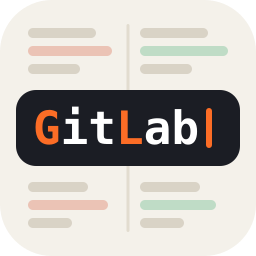
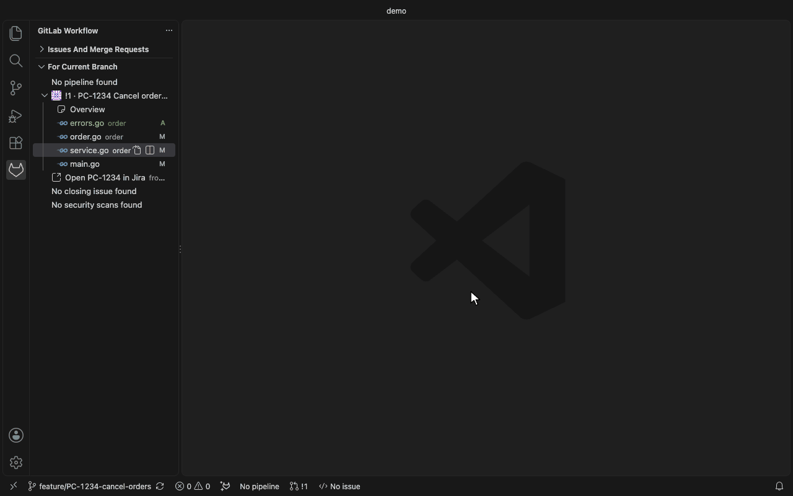
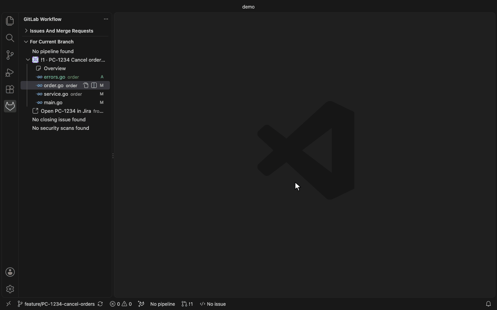
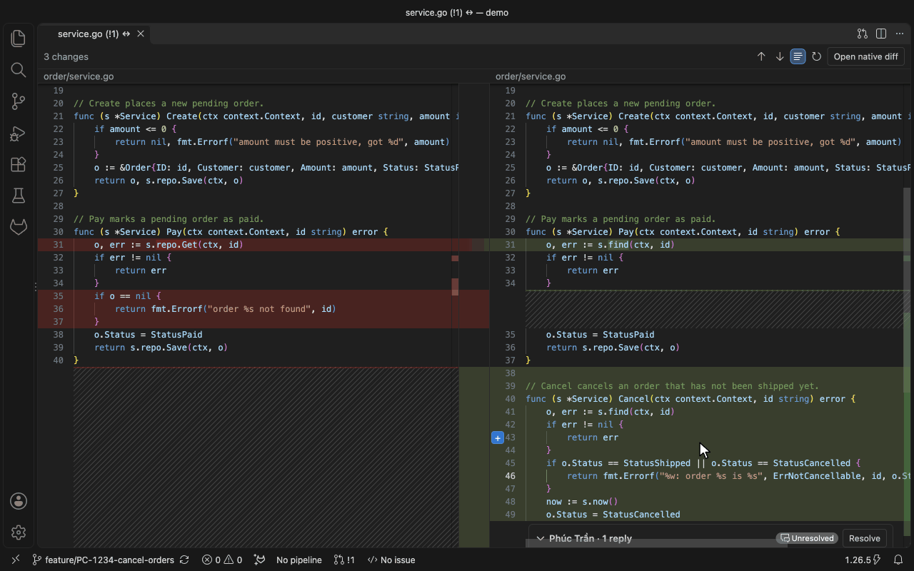
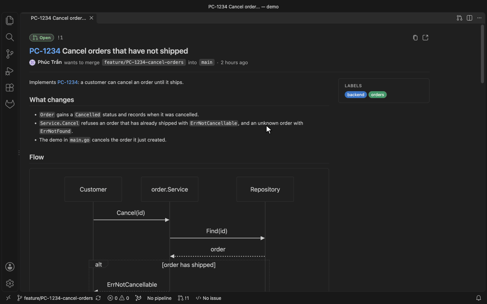
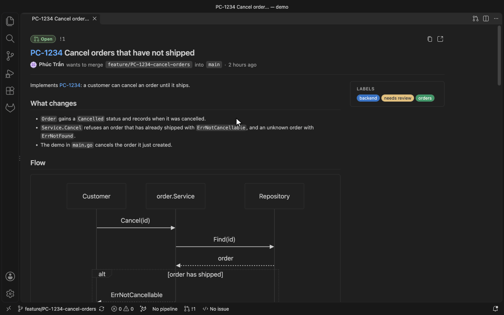

<p align="center">
  
</p>

# Review for GitLab

Review merge requests on a self-hosted GitLab 13.x from VS Code, in a side-by-side diff, and work
with its issues and pipelines on an instance older than upstream supports. A fork of
[GitLab Workflow](https://gitlab.com/gitlab-org/gitlab-vscode-extension), the GitLab extension
for VS Code.

> This is an unofficial extension. It is not affiliated with, maintained or endorsed by GitLab
> Inc. or JetBrains s.r.o. GitLab is a trademark of GitLab Inc.; JetBrains is a trademark of
> JetBrains s.r.o.



## Highlights

- [Side-by-side merge request diff](#side-by-side-diff): both versions with ribbons between the
  changes and the discussions inline, where you reply, resolve and start new threads.
- [Paste images into review comments](#merge-request-review): `cmd + v` on a screenshot uploads
  it to the merge request's project and inserts the Markdown.
- [Approve, merge and edit from VS Code](#merge-request-actions): one quick pick for approve,
  merge, draft, reviewers, assignees and labels.
- [Go to Definition in a review diff](#merge-request-review): `cmd + click` on `ErrNotCancellable`
  in the diff opens `errors.go` when your checkout has the same file.
- [Jira keys become links](#jira-links): `PC-1234` in a branch, title or comment opens your Jira.
- [Mermaid in the Overview](#overview), and a comment box with Write and Preview, in your VS Code
  theme.
- [Works on GitLab 13.12](#compatibility): adding an account no longer needs
  `personal_access_tokens/self`, which arrived in GitLab 15.5.

## Install

- [Visual Studio Marketplace](https://marketplace.visualstudio.com/items?itemName=tranphucbol.review-for-gitlab)
- A `.vsix` from the [releases](https://gitlab.com/tranphucbol/vscode-jetbrain-gitlab/-/releases)
  of this project

Or run `ext install tranphucbol.review-for-gitlab` from the command palette quick open
(`cmd + p` / `ctrl + p`). It needs VS Code 1.82 or later.

> Installed it as `tranphucbol.jetbrain-gitlab`? That ID is no longer published. Uninstall it and
> install `tranphucbol.review-for-gitlab`; your `gitlab.*` settings carry over.

> Coming from `GitLab.gitlab-workflow`? This extension is a fork of it and keeps the same
> `gitlab.*` settings and command IDs, so your settings carry over. Uninstall or disable GitLab
> Workflow first, otherwise both register the same commands, views and settings. Sign in with a
> personal access token; OAuth sign-in to GitLab.com belongs to the official extension.

## Setup

1. Create a personal access token with the `api` scope on your GitLab: **User Settings** →
   **Access Tokens**.
2. Run **GitLab: Add Account to VS Code**, enter the URL of your GitLab, for example
   `https://gitlab.example.com`, and paste the token. To skip this step on machines you rebuild
   often, set `GITLAB_WORKFLOW_INSTANCE_URL` and `GITLAB_WORKFLOW_TOKEN` before VS Code starts.
3. Open a clone of a project on that GitLab. The GitLab view in the activity bar lists your
   issues and merge requests, and the status bar shows the pipeline and merge request of the
   current branch.
4. Expand a merge request and select a changed file to review it in the side-by-side diff.

## How it works

The extension is built from GitLab Workflow v3.101.1. Everything it shows comes from your GitLab's
REST and GraphQL APIs, called with your token from VS Code; nothing goes through a third party.

The fork keeps upstream's code and adds what a GitLab 13.12 instance needs:

- an endpoint newer than the instance answers 404, and the extension reads that as "not supported
  here", not as a bad token
- features that need a newer GitLab check for it and stay out of the way, without errors
- merge request actions use only REST routes and GraphQL mutations that 13.12 has

It works on newer GitLab too, including GitLab.com with a token: the images on this page were
recorded against a project on GitLab.com. See [Compatibility](#compatibility) for what needs a
newer GitLab.

## Features

### Merge request review

Select a changed file of a merge request in the sidebar to open it in the
[side-by-side diff](#side-by-side-diff), with the discussions inline on their lines. VS Code's
**Comments** panel lists every discussion too; selecting one opens the side-by-side diff on its
line. VS Code's diff editor opens only for images and for files the side-by-side diff can't show.

- **Comments**: start a thread on any line, reply, resolve and unresolve, edit and delete your
  comments. Slash commands such as `/assign @user` work in comments as they do on GitLab.
- **Paste images**: paste or drop an image into a comment box and it is uploaded to the merge
  request's project, the one the comment is created in, and inserted as Markdown. Pasting needs VS
  Code 1.97 or later; dropping a file works on every supported version. A failed upload shows a
  notification and leaves the comment as it was.

  

- **Code navigation**: Go to Definition, Find References and hover work on both sides of the
  diff, through the language server of your local file, when the local file has the same content
  as the merge request version. Check out the merge request branch for that. A local file with
  unsaved or different changes gives no answer rather than a wrong line.

  

- **Check out the branch**: **Check out Merge Request Branch** on a merge request in the sidebar
  checks out its source branch. **GitLab: Fetch and Update Merge Request Branch** fetches it and
  moves your local branch to the remote one; when your local branch has commits the remote does
  not, it asks before dropping them and tells you how to get them back. It is offered for merge
  requests from the same project.

### Side-by-side diff

Selecting a changed file in the sidebar, or a discussion in the **Comments** panel, opens a view
that shows both versions next to each other.

- **Ribbons and alignment**: the changes are joined by ribbons across the gutter, and hatched
  filler keeps both sides on the same row. **Align both sides** in the toolbar turns the filler
  off; scrolling then maps one side onto the other. The choice is remembered.
- **Discussions inline**: threads sit under the line they belong to. Reply, resolve, edit, delete
  and start a thread from the `+` next to a line number. `cmd + enter` / `ctrl + enter` comments on
  the cursor's line. Comments have Write and Preview tabs and take pasted images, like the native
  review.
- **Navigation**: the toolbar counts the changes and moves between them, as do `f7` and
  `shift + f7`. Hover, Go to Definition and Find References work as in the native review.
  **Refresh** loads the latest version of the merge request and its discussions.
- **Go to Source**: right-click a line, or a selection, in either side and choose **Go to Source**
  to open your local file on the same lines. The lines are found by their content, so they open
  right even when your checkout has moved on; when the local file changed them, the closest lines
  are selected and the status bar says so. Without a local file, the merge request's version
  opens instead.
- **Your keys**: the keys are VS Code keybindings, so you can change them in **Keyboard
  Shortcuts**. A key you or a keymap extension bound to the diff editor's **Go to Next/Previous
  Change**, to **Go to Definition** or **Go to Declaration**, or to **Find References** works in
  the code panes too, as long as its `when` clause names nothing beyond editor focus, a diff, the
  file's language and the side-by-side diff. Keys from `keybindings.json` of a profile other than
  the default one are not read.
- **Files it can't show**: a binary file or one larger than 2 MB shows why, with **Open native
  diff** to open it in VS Code's diff editor instead.
- **Copy a change locally** (`gitlab.mergeRequestDiff.showLocalChangeButtons`): arrows copy a
  change into your local file, when it equals the old version, or revert it there, when it equals
  the new one. The file is checked first, and the change is an unsaved edit you can undo. Off by
  default.

### Merge request actions

**GitLab: Merge Request Actions…** opens one quick pick for a merge request, from the sidebar, a
review diff's title bar, the side-by-side diff, the Overview or the command palette.

- **What it offers**: approve or revoke your approval, merge, merge when the pipeline succeeds,
  cancel that, mark as draft or ready, edit reviewers, assignees and labels, close or reopen, and
  open the Jira issue. The title shows the merge request's state and whether it can be merged.
- **What it does not offer**: actions you cannot take are listed under **Not available** with the
  reason, for example "You are not allowed to approve it".
- **Safe writes**: merge, cancelling an automatic merge and close ask first. A merge sends the
  commit you saw, so it is refused if someone pushed in the meantime. After a change, the sidebar,
  status bar and open views refresh.



### Overview

Select **Overview** under a merge request, or an issue in the sidebar, to open its description,
labels, activity and comments in a tab.

- **Your theme**: the Overview takes its colours from your VS Code theme.
- **Mermaid**: `mermaid` code blocks in descriptions and comments render as diagrams, with a
  button to show the source and one to copy it.
- **Comment box**: Write and Preview tabs, pasted images uploaded as in the review, and `escape`
  to close a reply.



### Jira links

Set `gitlab.jira.url` to the base URL of your Jira, for example `https://jira.example.com/`, and
keys such as `PC-1234` link to `https://jira.example.com/browse/PC-1234`. The extension never
calls Jira; it only builds links. With the setting empty, nothing changes.

- **Where keys link**: review comments as they are displayed, the title, description and comments
  in the Overview, and notes and previews in the side-by-side diff. The comment stored on GitLab
  is not changed. Keys in code, code blocks and existing links are left alone.
- **Open the issue**: **GitLab: Open Jira Issue** looks in the current branch name, then the title
  and description of its open merge request, and opens the key it finds or lets you pick one. The
  same is offered as **Open PC-1234 in Jira** under the merge request in the sidebar, on its
  context menu and in **Merge Request Actions…**, up to five keys each.
- **Which keys**: `gitlab.jira.projectKeys` limits links to your projects and lets lowercase keys
  in branch names, such as `feature/pc-12-login`, match. `gitlab.jira.ignoredProjectKeys` lists
  prefixes that look like keys but are not, such as `SHA-256`.

### Branch and pipeline

- **Status bar**: the pipeline of the last commit, the merge request of the current branch and the
  issue it closes. Select the pipeline for its actions, the others to open them on GitLab.
- **Pipeline actions**: **GitLab: Pipeline Actions - View, Create, Retry, or Cancel** works on the
  current branch's latest pipeline. The sidebar lists its jobs, including downstream pipelines,
  where you can retry, cancel or run a job and download its artifacts.
- **Job output**: select a job to open its log in a tab. A running job's log updates as it runs;
  **Scroll to Bottom** follows it.
- **Notifications** (`gitlab.showPipelineUpdateNotifications`): a message when the pipeline status
  changes. Off by default.


### Issues and merge requests

- **Sidebar**: issues and merge requests assigned to you, created by you, to review, and every
  open merge request of the project. Each list is a query in `gitlab.customQueries`; see
  [custom queries](docs/user/custom-queries.md) for the fields.
- **Search with filters**: **GitLab: Search Project Issues (Supports Filters)** and **GitLab:
  Search Project Merge Requests (Supports Filters)** open the results on GitLab. Type words to
  search titles and descriptions, or combine tokens:
  `title: cancel orders author: alice assignee: bob labels: backend, orders milestone: 13.12`.
  The tokens are `title`, `labels` (comma-separated), `label` (repeatable), `milestone`, `author`,
  `assignee` and `scope` (`created-by-me`, `assigned-to-me` or `all`). The `:` after a token is
  required; quotes are not.
- **Advanced Search**: **GitLab: Advanced Search (Issues, Merge Requests, Commits, Comments...)**
  opens GitLab's search page with your query. Advanced Search syntax needs Elasticsearch on your
  GitLab; without it, GitLab runs its basic search.
- **Open on GitLab**: the current project, the merge request for the current branch, a new issue
  or merge request, and what is assigned to you. **GitLab: Compare Current Branch with Default
  Branch** opens the comparison.

### Snippets, CI/CD and repository

- **CI/CD configuration**: **GitLab: Validate GitLab CI/CD Configuration** lints the open
  `.gitlab-ci.yml` on your GitLab, and **GitLab: Show Merged GitLab CI/CD Configuration** shows it
  with every `include` resolved, updated when you save.
- **CI/CD variables**: typing `$` lists the predefined variables in `.gitlab-ci.yml` and any
  `.gitlab-ci*.yml` or `.yaml` file.
- **Snippets**: **GitLab: Create Snippet** from a file or selection, **GitLab: Insert Snippet**
  with multi-file snippets, and **GitLab: Create Snippet Patch** / **GitLab: Apply Snippet Patch**
  to pass a `git diff` around through a snippet.
- **Files**: **GitLab: Open Active File on GitLab** and **GitLab: Copy Link to Active File on
  GitLab** keep the selected lines.
- **Clone**: **Git: Clone** searches the projects you are a member of on every GitLab you added.
  Over HTTPS, your token is used to clone, fetch and push.

### Browse a repository without cloning

**GitLab: Open Remote Repository** opens a project of a GitLab you added at a branch or tag, as a
read-only folder. Select a project from the list, or enter a `gitlab-remote://` URL; see
[the URL format](docs/user/remote-fs-url-format.md) to add one to a workspace file.

## Compatibility

Checked against GitLab 13.12.10 Community Edition with the calls the extension makes. Everything
under [Features](#features) works there, except snippets, which were not exercised.

These upstream features need a newer or paid GitLab. On 13.12 they are absent without an error:

| Feature                                  | Needs                                |
| ---------------------------------------- | ------------------------------------ |
| Code Suggestions                         | GitLab 16.1 or later with GitLab Duo |
| Duo Chat                                 | GitLab 16.x or later with GitLab Duo |
| Security findings of the current branch  | GitLab 16.1 or later, Ultimate       |
| `vulnerabilities` type in custom queries | GitLab Ultimate                      |
| `epics` type in custom queries           | GitLab Premium                       |

The oldest GitLab the extension starts with is 13.6; below it, it warns once.

## Commands

The fork adds these commands.

| Command                  | Title                                         | Where                                                                           |
| ------------------------ | --------------------------------------------- | ------------------------------------------------------------------------------- |
| `gl.mergeRequestActions` | GitLab: Merge Request Actions…                | palette, sidebar, review diff, side-by-side diff, Overview                      |
| `gl.updateMrBranch`      | GitLab: Fetch and Update Merge Request Branch | merge request from the same project in the sidebar                              |
| `gl.openJiraIssue`       | GitLab: Open Jira Issue                       | palette, current branch view, merge request menu; when `gitlab.jira.url` is set |

- **Merge Request Actions…** without a merge request uses the focused side-by-side diff or
  Overview, then the current branch's merge request.
- **Fetch and Update Merge Request Branch** fetches the source branch and moves the local branch
  to it, asking before it drops local commits.
- **Open Jira Issue** opens the Jira key of the current branch or its merge request.

These run in the side-by-side diff, and are in the palette while it is the active editor:

| Command                       | Title                                       | Default key                      |
| ----------------------------- | ------------------------------------------- | -------------------------------- |
| `gl.sideBySideNextChange`     | GitLab: Side-by-Side Diff: Next Change      | `f7`                             |
| `gl.sideBySidePreviousChange` | GitLab: Side-by-Side Diff: Previous Change  | `shift + f7`                     |
| `gl.sideBySideCommentOnLine`  | GitLab: Side-by-Side Diff: Comment on Line  | `cmd + enter` / `ctrl + enter`   |
| `gl.sideBySideGoToDefinition` | GitLab: Side-by-Side Diff: Go to Definition | none; `f12` works in a code pane |
| `gl.sideBySideGoToSource`     | GitLab: Side-by-Side Diff: Go to Source     | none; also in the context menu   |

To move between changes with `alt + down` and `alt + up` instead of `f7`, add to
`keybindings.json`:

```jsonc
[
  {
    "key": "alt+down",
    "command": "gl.sideBySideNextChange",
    "when": "activeWebviewPanelId == 'gitlab.mergeRequestDiff'"
  },
  {
    "key": "alt+up",
    "command": "gl.sideBySidePreviousChange",
    "when": "activeWebviewPanelId == 'gitlab.mergeRequestDiff'"
  },
  { "key": "f7", "command": "-gl.sideBySideNextChange" },
  { "key": "shift+f7", "command": "-gl.sideBySidePreviousChange" }
]
```

Keep the `when` clause: without it the key is taken from every editor, where the command does
nothing.

Upstream's commands keep their names; type `GitLab:` in the command palette to list them.

## Extension Settings

### Merge request diff

- `gitlab.mergeRequestDiff.showLocalChangeButtons`, default `false`

  Show the arrows in the side-by-side diff that copy a change into your local file, or revert it
  there, as an unsaved edit.

### Jira

- `gitlab.jira.url`, default `""`

  Base URL of your Jira, for example `https://jira.example.com/`. Empty turns Jira links off.

- `gitlab.jira.projectKeys`, default `[]`

  Jira project keys to link, for example `["PC", "PE"]`. Empty links any key shaped like a Jira
  key. Listing keys also lets lowercase keys in branch names match.

- `gitlab.jira.ignoredProjectKeys`

  Prefixes that look like Jira keys but are not. Ignored when `gitlab.jira.projectKeys` is set.

  Default value:

  ```json
  [
    "AES",
    "CVE",
    "GMT",
    "HTTP",
    "ISO",
    "MD",
    "RFC",
    "RSA",
    "SHA",
    "SSL",
    "TLS",
    "UTC",
    "UTF",
    "WCAG"
  ]
  ```

### General

- `gitlab.customQueries`

  The lists in the GitLab sidebar. See [custom queries](docs/user/custom-queries.md).

- `gitlab.showProjectMergeRequests`, default `true`

  Show the "All project merge requests" list.

- `gitlab.pipelineGitRemoteName`, default `null`

  The Git remote whose project runs your pipelines. Empty uses the same remote as everything else.

- `gitlab.showPipelineUpdateNotifications`, default `false`

  Show a message when the pipeline status changes.

- `gitlab.ca`, `gitlab.cert`, `gitlab.certKey`, default `null`; `gitlab.ignoreCertificateErrors`,
  default `false`

  A custom CA, client certificate and key, or no certificate check, for a GitLab behind a
  self-signed certificate. See [Troubleshooting](#troubleshooting).

- `gitlab.debug`, default `false`

  Source-mapped stack traces and debug lines in the **GitLab Workflow** output. Restart the
  extension after changing it.

## Troubleshooting

- **Logs**: the **GitLab Workflow** channel in the Output panel. Turn on `gitlab.debug` for more.
- **Self-signed certificate**: see the [SSL guide](docs/user/ssl.md) and the
  [certificate settings](docs/user/troubleshooting.md#settings-for-self-signed-certificates).
- **Wrong project**: the extension matches your Git remote with the URL of an account. If it
  picks the wrong one, right-click the repository in the GitLab sidebar and select the project.
- **Token in environment variables**: an account added in VS Code for the same URL takes
  precedence over `GITLAB_WORKFLOW_TOKEN`.

Report a problem in this project's
[issues](https://gitlab.com/tranphucbol/vscode-jetbrain-gitlab/-/issues), not upstream's.

## Release Notes

See [CHANGELOG.md](CHANGELOG.md).

## Development

```sh
npm ci                    # Node 24.22.1; run it in webviews/vue and webviews/vue2 too
npm run watch:desktop     # esbuild watch into dist-desktop/
npm run test:unit         # jest over src/
npm run lint              # eslint, prettier and both webview lints
npm run package           # the .vsix in dist-desktop/
```

To try the extension, open the repository in VS Code and start **Run Extension** from the "Run and
Debug" view. [AGENTS.md](AGENTS.md) describes the layout and the rules a change follows.

## Credits

Created by [Fatih Acet](https://gitlab.com/fatihacet) as GitLab Workflow and developed by
[GitLab](https://gitlab.com/gitlab-org/gitlab-vscode-extension) and its
[contributors](CONTRIBUTORS.md). This fork is maintained by
[tranphucbol](https://gitlab.com/tranphucbol).

If you find it useful, a rating on the
[Marketplace](https://marketplace.visualstudio.com/items?itemName=tranphucbol.review-for-gitlab&ssr=false#review-details)
or a star on [GitLab](https://gitlab.com/tranphucbol/vscode-jetbrain-gitlab) is appreciated.
