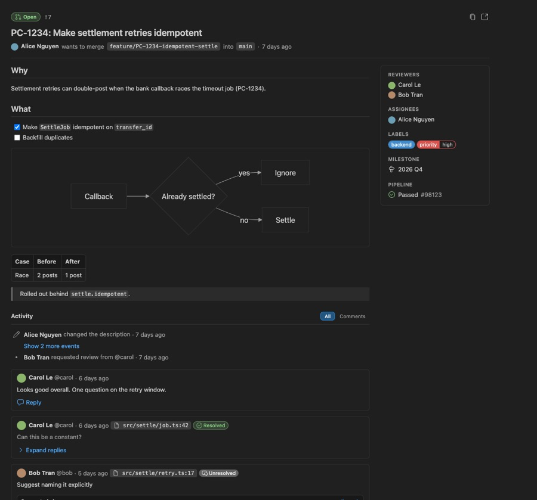
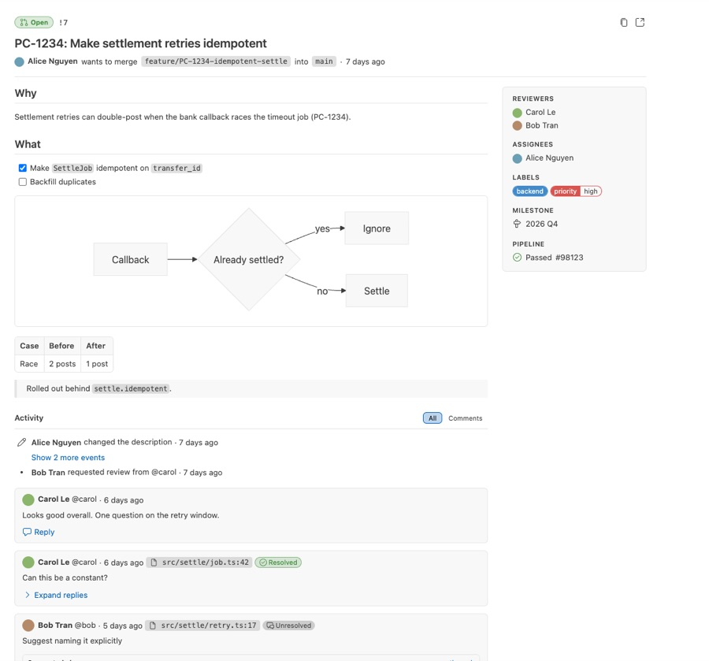
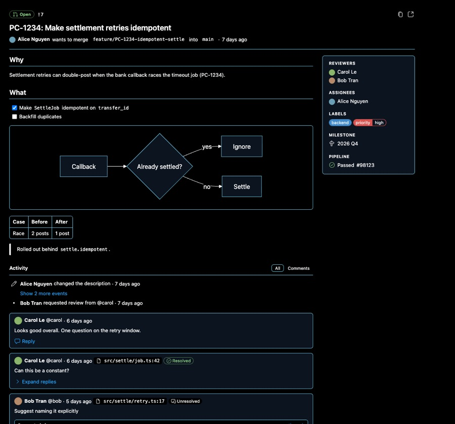
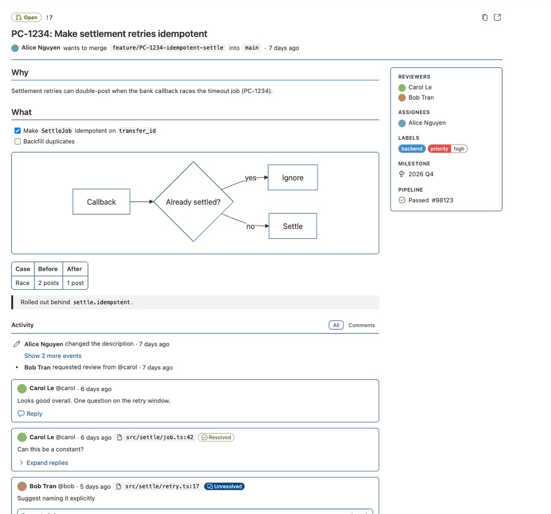

# 010 - The Overview is themed by VS Code tokens

**Status:** accepted - 2026-10-17
**Status:** token file moved to `webviews/vue/shared/` and shared with the side-by-side diff by [012](012_the-webviews-and-commands-share-one-look-and-voice.md) - 2026-10-18

**Plan:**
[docs/plans/006_modern-overview-webview.md](../plans/006_modern-overview-webview.md)
records the detailed investigation and implementation path.

## Context

The merge request and issue Overview (`webviews/vue/issuable/`) still looked
like a 2019 copy of GitLab's web page: literal GitLab greens and blues,
40px floated avatars, a timeline line with circles for every system note, and
icons drawn as one-off Vue components. In a dark or high-contrast theme parts of
it were unreadable, and next to VS Code's own views it read as foreign.

The decision is constrained by:

- The host contract does not change: the messages of `issuable_controller.ts`
  and the webview CSP (nonce-only scripts, `img-src vscode-resource: https:`, no
  `font-src`, no `frame-src`) stay as they are.
- HTML from GitLab enters only through `v-safe-html`; the `js-*` hooks the
  tests and the host rely on stay.
- The webview is Vue 3 in `@vue/compat` mode 2; a component library built for
  Vue 3 proper or for the browser at large fights that.
- The fork stays close to upstream (see Rules in `AGENTS.md`); the change is
  confined to `webviews/vue/issuable/`, `vite.config.shared.js` and the webview
  package files.

## Evidence

Checked in headless Chromium against the built webview, with VS Code's Dark
Modern, Light Modern, High Contrast Dark and High Contrast Light variable sets
on `body`, 2026-10-17.

| Check                                                                 | Result                                                                                                                                                                                                                                     | Consequence                                                                                                     |
| --------------------------------------------------------------------- | ------------------------------------------------------------------------------------------------------------------------------------------------------------------------------------------------------------------------------------------ | --------------------------------------------------------------------------------------------------------------- |
| `grep -rnE '#[0-9a-fA-F]{3,8}\b'` over issuable `*.vue` and `*.scss`  | no match                                                                                                                                                                                                                                   | every colour comes from a token or a CSS system colour                                                          |
| `var(--vscode-` outside `styles/tokens.scss`                          | no match                                                                                                                                                                                                                                   | one file maps VS Code tokens to the Overview's own `--gl-*` names                                               |
| Four themes, 1180px wide                                              | all text, chips, state pills and diagrams readable; screenshots below                                                                                                                                                                      | derived tokens are declared on `body`, so the high-contrast class wins                                          |
| VS Code 1.142.0 `getWebviewThemeData()` and workbench CSS             | webviews receive `--vscode-cornerRadius-{xSmall,small,medium,large,circle}` (2, 4, 6, 8, 9999px) and `--vscode-strokeThickness`; buttons and inputs use `small`, code blocks, chat tables and action bar buttons `medium`, widgets `large` | corners come from the same tokens; `--vscode-shadow-*` is not sent, so the shadow is built from `widget.shadow` |
| Computed styles in Dark Modern                                        | cards, tables, figures 6px; buttons and inputs 4px; floating toolbar 8px; pills and avatars circular; primary button 4px 8px, 12px text                                                                                                    | the Overview matches the workbench, not GitLab                                                                  |
| High contrast, pressed **All / Comments** filter                      | in button colours the pressed button had the page's background and was invisible                                                                                                                                                           | the filter uses `inputOption.activeBorder`, which high contrast themes set                                      |
| 500px wide                                                            | the sidebar folds into a wrapped row above the description                                                                                                                                                                                 | a container query, not a media query, decides the layout                                                        |
| Keyboard walk and accessible names of every button, link and textarea | focus ring visible on every control (orange in high contrast); no unnamed control                                                                                                                                                          | icon-only buttons carry `title` and `aria-label`                                                                |
| Codicon glyphs as inline SVG under the nonce-only CSP                 | rendered; no CSP report                                                                                                                                                                                                                    | no font, no `font-src`, no `data:` URL                                                                          |

| Dark Modern                                           | Light Modern                                            |
| ----------------------------------------------------- | ------------------------------------------------------- |
|           |           |
| **High Contrast Dark**                                | **High Contrast Light**                                 |
|  |  |

## Decision

The Overview takes every colour, font and border from VS Code's `--vscode-*`
theme variables, each with a fallback, and draws its icons with codicons; it no
longer imitates GitLab's web page.

- **Tokens.** `issuable/src/styles/tokens.scss` is the one file that reads
  `--vscode-*`. It declares `--gl-*` tokens on `body` with a fallback chain that
  ends in another token or a CSS system colour (`CanvasText`, `GrayText`,
  `LinkText`, …), never a literal colour. `body.vscode-high-contrast` and
  `body.vscode-high-contrast-light` swap borders to `contrastBorder` and drop
  tints. Components and `markdown.scss` use only `--gl-*`.
- **Shape.** Corners, borders and buttons follow VS Code's own components,
  through the shape tokens it sends to webviews (`--vscode-cornerRadius-*`,
  `--vscode-strokeThickness`, `--vscode-bodyFontSize-small`), with VS Code's
  defaults as fallbacks. Buttons, inputs, inline code and chips use `small`
  (4px); code blocks, tables, Mermaid figures, comment cards and toolbar
  buttons use `medium` (6px); floating toolbars use `large` (8px); pills,
  badges and avatars use `circle`. Text buttons copy `.monaco-text-button`
  (4px 8px padding, 16px line height, `button.border` and
  `button.secondaryBorder`, a focus outline 2px outside). The **All /
  Comments** filter is an option toggle in the `inputOption.active*` colours.
  Tables, like VS Code's chat, use separate borders inside a rounded frame.
  The `_mixins.scss` mixins `text-button` and `toolbar-button` are the only
  button styles.
- **Icons.** Codicons from `@vscode/codicons` (a dev dependency) are imported as
  raw SVG through `assets/codicons.js` and rendered by `CodiconIcon.vue`, which
  parses each glyph once and emits vnodes in `currentColor`. Unknown names fall
  back to `circle-small-filled`.
- **Layout.** A header (state pill, short reference, draft, title, author and
  branches, copy reference and **Open in GitLab** buttons), the description,
  and an **Activity** timeline, beside a 240px sidebar of reviewers, assignees,
  labels, milestone and pipeline that folds above the description below 720px.
  The sidebar is a card like the comment threads. A merge request opened from
  the sidebar list is a list item without `head_pipeline`, so the host loads
  `getMrDetail()` when the Overview opens and falls back to the list item if
  that fails.
  System notes and label events are one muted line each, three or more in a row
  fold into **Show N more events**, and comment threads are cards with file
  chip, resolved state and indented replies.
- **Unchanged.** The message contract, `v-safe-html` and the `js-*` hooks.

### Attribution

Codicon glyphs are © Microsoft Corporation, licensed under
[CC BY 4.0](https://creativecommons.org/licenses/by/4.0/), from
[microsoft/vscode-codicons](https://github.com/microsoft/vscode-codicons).
They are bundled unmodified as SVG.

## Consequences

- The Overview follows the user's theme, including both high-contrast themes,
  and looks like the editor it sits in.
- A new colour is a token in one file, not a literal in a component; the hex
  grep keeps it that way.
- The webview diverges further from upstream's; a rebase that touches
  `webviews/vue/issuable/` resolves by hand.
- Label colours come from label events in the discussions; a label with no event
  shows the neutral badge colour until GitLab's `with_labels_details` is usable.
- Revisit when VS Code renames or retires the variables `tokens.scss` maps, or
  when upstream rewrites the Overview.

## Alternatives rejected

- **Port `@gitlab/ui`.** It would bring back GitLab's palette and a Vue 2 /
  Bootstrap stack into a Vue 3 compat build, the opposite of looking like VS
  Code.
- **`@vscode/webview-ui-toolkit`.** Deprecated in 2024, and its web components
  fight `@vue/compat` event and attribute handling.
- **The codicon font through a `data:` URL.** Needs a `font-src` change to the
  host's CSP for icons that inline SVG draws without one.
- **Keep GitLab's layout and only fix the colours.** The timeline circles,
  floated 40px avatars and full-width header were what made it read as foreign;
  colours alone left that.
